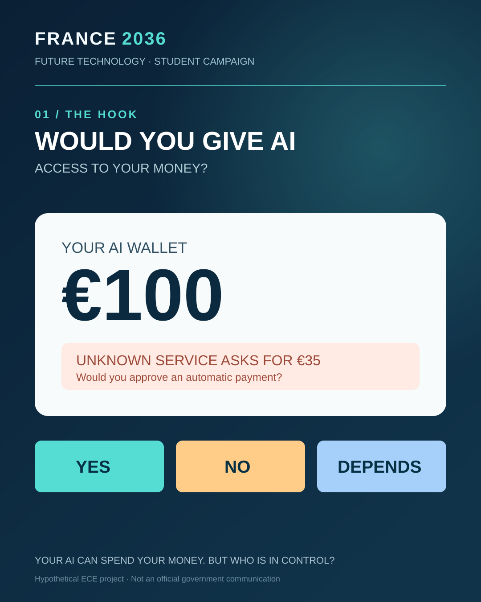
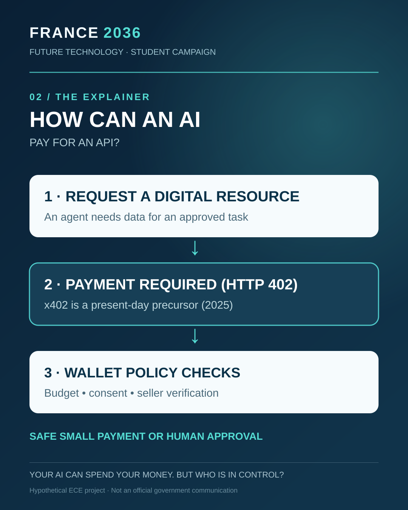
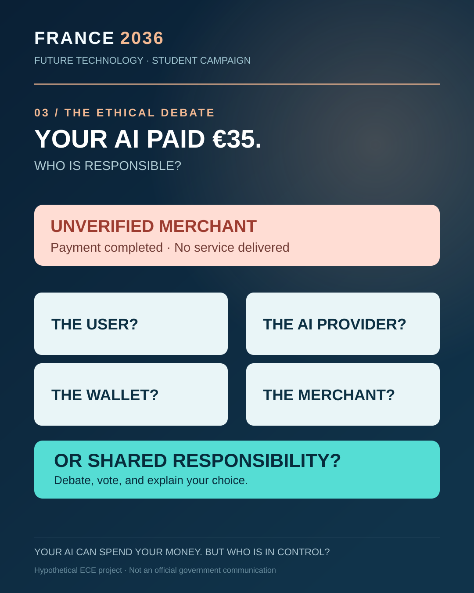

# FRANCE 2036 — Autonomous AI Payments

**Your AI Can Spend Your Money. But Who Is in Control?**

ECE engineering-school project · **France / 2036–2040** · hypothetical public-policy client: **the French Ministry of the Economy and Finance**.

> **Independent educational simulation.** Not affiliated with or endorsed by the French government. No real payments, wallet keys, users' financial data or blockchain operations.

## The idea

A future AI agent might buy a €0.10 digital API call within a task budget. But what happens when an **unverified service asks for €35**? Should the agent pay automatically, wait for human consent, or reject the offer?

x402 and HTTP 402 payments existed before our 2036 scenario. The wallet, spending controls and consumer-policy proposals shown here are **fictional future concepts**, not current commitments by any regulator or company.

## Try the live classroom simulator

**[Open the demo source](live-demo/index.html)** — a responsive, standalone HTML file with embedded CSS and JavaScript. Download it and open locally, or clone the repository and run:

~~~bash
python3 -m http.server 8000
# Open http://localhost:8000/live-demo/
~~~

In the simulated demo:
1. Choose an automatic spending limit (the default is €1).
2. Make a verified €0.10 purchase from a €50 task budget.
3. Confront the €35 unknown-merchant request.
4. Ask the class to choose **PAY / ASK / REJECT** and see the consequence.
5. Use **YES / NO / DEPENDS** voting and debate protection versus innovation.

No backend, payment processor, cookies, accounts or external dependencies are used.

## Social-media concepts

Three editable vector visuals plus complete captions:

| Hook | Explain | Debate |
|---|---|---|
|  |  |  |
| Would you give an AI €100? | How can software pay for data? | Who is responsible for a failed €35 payment? |

The campaign artwork is hypothetical; it does not represent an official French state account or imply publication.

## Files currently published here

- [Interactive wallet simulator](live-demo/index.html) — self-contained web app with audience interaction.
- [Research paper — extracted text](research/France2036_Research_Paper_Text.md) — APA citations; formatted PDF/DOCX are in the external handoff package.
- [Research references and evidence boundaries](sources/APA_REFERENCES.md).
- [10-minute / four-speaker presenter guide](presenter/10_MINUTE_PRESENTATION_GUIDE.md).
- [Final submission checklist](presenter/SUBMISSION_CHECKLIST.md).
- [Email draft to the teacher](presenter/EMAIL_TO_TEACHER.md) — **not sent**.
- [Video script](video/VOICEOVER_SCRIPT.md) — four speakers, 75 seconds.
- [Three social captions](social/CAPTIONS_AND_POSTING_GUIDE.md) and vector post mockups in the social folder.

### Media still to upload

The complete original **PowerPoint with embedded video, the PDF export, the formatted research DOCX/PDF, the two MP4 videos and the full PNG illustrations** were prepared in a separate ZIP handoff. **They have not yet been uploaded to this GitHub repository.** The GitHub integration available to this environment can write text, source code and SVG, but cannot transfer the local binary files directly.

To finish, download the full campaign ZIP supplied with the project, clone this repository, extract its contents into the clone and commit/push the new or replaced files.

## 10-minute pitch

| Time | Content |
|---|---|
| 0:00–1:15 | 75-second opening video |
| 1:15–3:05 | Future agents, x402 precursor and possible benefits |
| 3:05–5:05 | French stakeholders and first vote |
| 5:05–7:05 | Interactive €50 wallet; suspicious €35 payment |
| 7:05–9:05 | Ethical battle, frameworks and second vote |
| 9:05–10:00 | Three policy recommendations |

## Academic integrity

The teacher requires writing that reflects the group's **actual natural English proficiency** and warns that directly submitted AI text may be rejected. The report is a **research draft** for group verification and rewriting. Use these materials as preparation, do not submit the text unchanged.

The final written paper must be sent to the teacher **before the presentations start** on class day.

---

**Scenario date:** 2036–2040. **Sources date:** mainly 2025–2026. **No official endorsement.**
